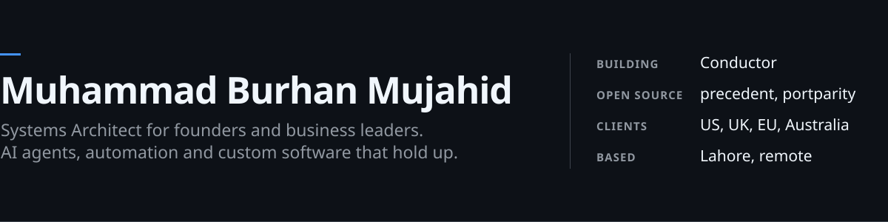

<picture>
  <source media="(prefers-color-scheme: dark)" srcset="assets/hero-dark.svg">
  <source media="(prefers-color-scheme: light)" srcset="assets/hero-light.svg">
  
</picture>

  
  
  

## About

I work with **founders, executives and business leaders who own an outcome**. I build AI agents, automations and custom software, and I fix the ones that aren't working. I own the work end to end: I scope it honestly, design it, ship it, and hand it over so your team can run it without me.

6+ years building software and running operations · clients in the US, UK, Europe and Australia · UET Lahore alum

<table>
  <tr>
    <td width="50%" valign="top">
      <b>AI agents</b> 
      Agents that work inside your real tools (Shopify, Amazon, CRMs, Slack, Notion), with guardrails on what they're allowed to do.
    </td>
    <td width="50%" valign="top">
      <b>Automations</b> 
      Connections between the tools your team copies data between today, so the busywork stops.
    </td>
  </tr>
  <tr>
    <td width="50%" valign="top">
      <b>MVPs, SaaS and internal tools</b> 
      From validation to launch, plus mobile apps and backends built for real traffic.
    </td>
    <td width="50%" valign="top">
      <b>Straight answers</b> 
      Build, buy or stop, decided before budget is committed.
    </td>
  </tr>
</table>

## Selected client work

| Client | What I built | Result |
| --- | --- | --- |
| **E-commerce seller** | A custom MCP server that puts Amazon, Google Ads and Shopify behind one chat | Sales data, ad changes and inventory checks without opening a dashboard |
| **OpsPilot** (field service) | Mobile, web and backend architecture for tens of thousands of concurrent users, with AI job summaries | About **50%** less reporting time, **30–35%** better scheduling efficiency |
| **Live consumer app** | OTP login across WordPress and React Native | Shipped in **one week**, with no impact on existing users |

## Open source

<table>
  <tr>
    <td width="50%" valign="top">
      <h3><a href="https://github.com/burhan-mujahid/precedent">precedent</a></h3>
      
Stops AI agents from improvising policy. Precedent learns your house rules from the team's WhatsApp or Slack threads, has a person approve each one, and puts a deterministic gate in front of every action: <b>ACT</b>, <b>NEEDS APPROVAL</b> or <b>ESCALATE</b>. It fails closed. Since 0.2 it also <b>halts runs already in progress</b> when a step goes beyond what was approved.

      

        
        
        
      

      Python · MCP · LangGraph · CLI · <a href="https://burhan-mujahid.github.io/precedent/">Website</a>
    </td>
    <td width="50%" valign="top">
      <h3><a href="https://github.com/burhan-mujahid/portparity">portparity</a></h3>
      
Port legacy code with evidence. It runs the original and the replacement on the same inputs, uses the original as the oracle, and shrinks every mismatch to a minimal regression case. You get a report a reviewer can trust. Works for C# to Python, Java to Kotlin, Python 2 to 3, or v1 to v2.

      

        
        
        
      

      Python · agent skill · differential testing
    </td>
  </tr>
  <tr>
    <td width="50%" valign="top">
      <h3><a href="https://github.com/burhan-mujahid/canon">canon</a></h3>
      
The papers that built computing, rebuilt so you can run them. Turing, Shannon, Kálmán, Diffie–Hellman and PageRank, each as about a hundred readable lines, a playable page, and tests that reproduce the paper's own results.

      JavaScript · HTML · no build step · <a href="https://burhan-mujahid.github.io/canon/">Live site</a>
    </td>
    <td width="50%" valign="top">
      <h3><a href="https://github.com/burhan-mujahid/inverse-notebook">inverse-notebook</a></h3>
      
Move the result, see what must change. An interactive notebook for working backward from a target: lock the inputs that matter and inspect the smallest permitted changes, with every constraint explained. Runs on a small convex optimization engine in plain JavaScript.

      JavaScript · SVG · no runtime dependencies
    </td>
  </tr>
</table>

<b>Earlier projects</b>

 

| Project | What it is | Stack |
| --- | --- | --- |
| [buddy_open_ai_chat_bot](https://github.com/burhan-mujahid/buddy_open_ai_chat_bot) | An OpenAI chatbot app with voice input, spoken replies and image generation | Flutter · Dart |
| [memorygrid](https://github.com/burhan-mujahid/memorygrid) | A memory tile-matching game | Flutter · Dart |
| [nearby_sync_utility](https://github.com/burhan-mujahid/nearby_sync_utility) | A Flutter plugin for peer-to-peer device discovery and messaging (Nearby Connections on Android, Multipeer Connectivity on iOS), in development | Flutter · Kotlin · Swift |
| [Covid-19-Tracker](https://github.com/burhan-mujahid/Covid-19-Tracker) | Global and per-country COVID-19 statistics from the disease.sh API | Flutter · Dart |

## Now building: Conductor

Guard-railed AI actions across **Linear, Slack, Notion and Gmail**. Agents can do real work in your tools, and nothing irreversible happens without the right sign-off.

## Tools I work with

  

`MCP` · `Claude` · `LangGraph` · `Ollama` · `n8n` · `Make` · `Shopify` · `Amazon` · `Google Ads` · `Slack` · `Notion` · `Linear`

---

  <b>Something to build, a decision to make, or something not working?</b> 
  <a href="https://calendar.app.google/8BSdL6LsNgXprmGZ6">Book a free 30-minute call</a>. You leave with a clear plan either way.

